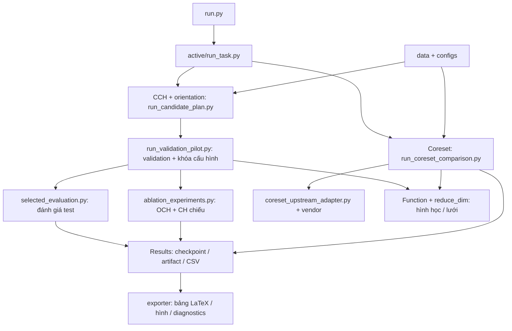

# ROCH-SVM 

Đọc file này để biết code nằm đâu; đọc [LO_TRINH.md](LO_TRINH.md) để biết việc đã xong và việc tiếp theo. Chạy mọi lệnh từ thư mục `code/`. File hướng dẫn nằm trong gói đóng băng chỉ phục vụ mang gói sang máy khác; hai tài liệu ở đây là chỉ dẫn cho workspace hiện tại.

## Cây thư mục

```text
code/
├── README.md               ← tổng quan, sơ đồ, cách chạy, bảng file
├── LO_TRINH.md             ← checklist thực hiện và đưa kết quả vào paper
├── run.py                  ← điểm chạy duy nhất cho cả ba bài toán
├── active/                 ← bộ chạy v2 đang dùng, đã khóa hash
│   ├── run_task.py         ← điều phối cch / coreset / orientation
│   ├── Function/           ← ROCH, OCH, CCH và tâm bao lồi
│   ├── reduce_dim/         ← lưới ha, hb, hg và phép chiếu
│   ├── configs/            ← danh sách cấu hình 300/100 đã chuẩn bị
│   ├── vendor/             ← code coreset tương thích + patch/license
│   ├── upstream_original/ ← nguyên bản coreset của tác giả
│   └── RELEASE.json        ← hash từng file của bộ chạy
├── data/                   ← CSV gốc; giữ nguyên vị trí và nội dung
├── Results/                ← checkpoint/kết quả, không trộn các giao thức
│   ├── rbf_v2/             ← sẽ tạo khi chạy CCH hoặc orientation bằng run.py
│   └── coreset_v2/         ← sẽ tạo khi chạy coreset bằng run.py
└── archive/                ← lịch sử; không phải điểm chạy benchmark mới
    ├── development_snapshot_20261114/ ← toàn bộ nguồn phát triển trước sắp xếp
    ├── releases/           ← ZIP v2 và release v1 cũ
    ├── verification/       ← báo cáo kiểm tra các phiên bản
    ├── references/         ← PDF tham khảo và ZIP upstream
    ├── cleanup_2026_11_13/  ← lịch sử dọn code cũ
    ├── legacy_docs_2026_11_14/ ← tài liệu hướng dẫn đã thay thế
    └── reorganization_20261114.json ← ánh xạ đường dẫn cũ → mới
```

`Results/rbf_v2` và `Results/coreset_v2` là đích mặc định mới, chưa hàm ý benchmark đã chạy. Kết quả lịch sử vẫn ở các thư mục cũ trong `Results/`.

## Sơ đồ phụ thuộc



## Chạy nhiều dataset

Cài dependency vào môi trường Python của máy chạy bằng `pip install -r active/requirements_validation.txt`. Trên máy hiện tại, môi trường đã có nằm ở `../.venv-roch`; Skin_NonSkin cần bổ sung imbalanced-learn.

```bash
# Từ code/, sau khi kích hoạt môi trường Python
python run.py --task cch --datasets haberman heart_statlog ionosphere --mode check
python run.py --task coreset --datasets haberman heart_statlog ionosphere --mode check
python run.py --task orientation --datasets haberman heart_statlog ionosphere --mode check
```

Mặc định chỉ check. Khi đến bước chạy trong lộ trình, đổi thành `--mode run`; xuất bảng/hình bằng `--mode export`. Dùng `--output Results/ten_dot_chay` nếu muốn chỉ định đích. Dữ liệu mặc định là `code/data`; đổi bằng `--data-dir`. Danh sách dataset/hash ở [active/DATASETS.md](active/DATASETS.md).

| Bài toán | Task | Đầu ra mặc định | Dùng vào paper |
|---|---|---|---|
| RBF ROCH/CCH/LibSVM | cch | Results/rbf_v2/paper_exports | main_table.tex, diagnostics_table.tex, Pareto validation |
| Linear ROCH/coreset/uniform | coreset | Results/coreset_v2 | paper_main.tex, paper_diagnostics.tex, completeness.json |
| Adaptive/OCH/CH chiếu | orientation | cùng Results/rbf_v2/paper_exports | ablation_table.tex, adaptive_vs_och.csv, adaptive_vs_projected_ch.csv |

CCH và orientation dùng cùng lượt tuning/checkpoint. Nếu CCH đã xong, chỉ cần export orientation. CH ở đây là CH trên phép chiếu 2D trong từng ô lưới. Nhánh coreset dùng linear SVM và C chung theo validation; không so trực tiếp số liệu này với RBF.

RBF dùng ngưỡng validation 0,5 điểm phần trăm so với accuracy validation tốt nhất của LibSVM; chọn cấu hình nhanh nhất đạt ngưỡng, nếu không đạt thì lấy accuracy tốt nhất và đánh dấu ngoại lệ. Không chọn cấu hình trên test. Xem lộ trình để biết bước khóa protocol và xử lý ngoại lệ.

## Review code theo chức năng

| Cần xem | File trong active/ |
|---|---|
| Điểm vào, CLI và kiểm tra hash | run_task.py |
| Candidate manifest, kế hoạch chạy | run_candidate_plan.py, configs/scientific_search_v2/ |
| Split, preprocessing, chọn validation | run_validation_pilot.py |
| Đánh giá cấu hình khóa và diagnostics | selected_evaluation.py |
| OCH/CH cùng cấu hình ROCH | ablation_experiments.py |
| Tâm diện tích CH và reducer | Function/function.py, reduce_dim/reduce_dim_v2.py, reduce_dim/grids.py |
| Coreset, trọng số, mục tiêu, kiểm tra gap | run_coreset_comparison.py, coreset_upstream_adapter.py |
| Bảng, hình và thống kê | export_paper_results.py, paper_figures.py, paper_statistics.py |
| Sinh ứng viên, chuẩn hóa, phụ thuộc runtime | prepare_candidate_plan.py, prepare_scientific_search.py, validation_candidates.py |
| Kiểm tra đã có | check_*.py |
| Nguồn upstream, khác biệt tương thích | upstream_original/, vendor/svm_coreset_compat/ |

Không sửa trực tiếp file đã khóa trong `active/` rồi chạy tiếp output cũ. Khi cần thay thuật toán/giao thức, tạo phiên bản mới và output mới. Nguồn trước sắp xếp được lưu nguyên trong archive/development_snapshot_20261114; các script gridsearch/model/pilot cũ nằm tại đó để tra cứu, không phải runner chính.

Các tài liệu bên trong active và archive được giữ vì thuộc gói tái lập/lịch sử/license. Không cần đọc chúng để theo dõi tiến độ: checklist chuẩn ở LO_TRINH.md. Nhật ký di chuyển cho phép tìm lại từng đường dẫn cũ.

## Gói chuyển sang máy khác

Bản mới loại cache Python khỏi hash: [ZIP đã chỉnh đóng gói](archive/releases/ROCH_SVM_comparison_suite_v2_organized.zip). Bản ZIP trước vẫn lưu để truy lại lịch sử. Mã nguồn thuật toán không đổi trong lần sắp xếp này.
